# GeekCubo

<picture>
  <source media="(prefers-color-scheme: dark)" srcset="./design/brand/geekcubo-logo-dark.png">
  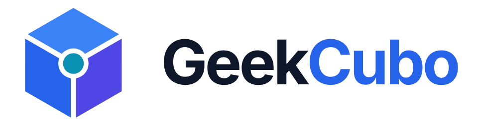
</picture>

**One gateway. Every AI model.**
A self-hosted, OpenAI-compatible AI gateway and LLM router. Bring your own provider keys; `model="auto"` picks a capable model for every request, with fallback and local cost tracking.

[](https://github.com/GeekCubo/GeekCubo-AI-Router/actions/workflows/ci.yml)
[](#license)
[](https://geekcubo.com)

[English](./README.md) | [日本語](./README.ja.md) | [中文](./README.zh.md) | [한국어](./README.ko.md) | [Deutsch](./README.de.md) | [Français](./README.fr.md) | [Español](./README.es.md) | [Italiano](./README.it.md) | [Русский](./README.ru.md) | [Português](./README.pt.md) | [Tiếng Việt](./README.vi.md) | [हिन्दी](./README.hi.md)

<sub>Translations are community-maintained and may lag behind this English README, which is the reference version.</sub>

<p align="center">
  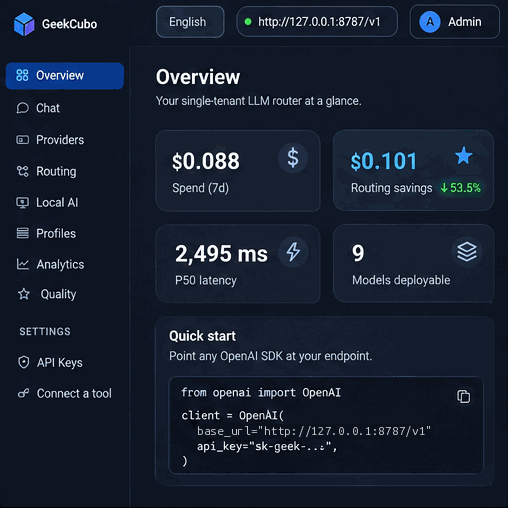<br>
  <sub><i>Illustrative interface. Models, providers and availability depend on your configuration.</i></sub>
</p>

## Contents

- [Why GeekCubo](#why-geekcubo) · [Features](#features) · [Architecture at a glance](#architecture-at-a-glance)
- [Install](#install) · [First-time administrator setup](#first-time-administrator-setup) · [Add providers](#add-providers)
- [API keys and endpoints](#api-keys-and-endpoints) · [Call it from an SDK](#call-it-from-an-sdk) · [Connect OpenCode and other tools](#connect-opencode-and-other-tools)
- [Automatic routing](#automatic-routing) · [Chat and attachments](#chat-and-attachments) · [Optional web search](#optional-web-search)
- [Local AI Connect](#local-ai-connect) · [Analytics and cost tracking](#analytics-and-cost-tracking) · [Security and deployment](#security-and-deployment)
- [Limitations](#limitations) · [Troubleshooting and documentation](#troubleshooting-and-documentation) · [Support GeekCubo](#support-geekcubo) · [License](#license)

## Why GeekCubo

Automatic model routing should give developers control, not uncertainty. With your own provider keys it is not always obvious which provider handles a request, whether a fallback might use a separately billed service, or why a particular model was chosen.

GeekCubo is a server you run yourself where routing policies, eligible providers, model capabilities, pricing assumptions and fallback behaviour are visible and configurable: **your keys, your infrastructure, your routing decisions.** There is no hosted account, no routing wallet and no dependency on a GeekCubo-operated host. Any provider that speaks the OpenAI API can be added; none is required.

GeekCubo builds on [OrcaRouter Lite](https://github.com/Continuum-AI-Corp/OrcaRouter-Lite), an open-source project released under the MIT License, and is independently developed and maintained. It is not affiliated with or endorsed by the original OrcaRouter developers. See [License](#license).

## Features

| Area | What you get |
|---|---|
| **APIs** | OpenAI-compatible `/v1/chat/completions` (streaming), Anthropic Messages `/v1/messages` (used by Claude Code), Gemini `/v1beta/models/...`, and `GET /v1/models` — all on one routing pipeline |
| **Auto routing** | `model="auto"` filters by eligibility, confirmed price, required capabilities and context window, then ranks with Balanced, Cheapest, Quality First, Adaptive or Adaptive-Gated |
| **Fallback** | Retryable upstream failures move to the next capable candidate; every decision is explained in `x-geek-routing-*` headers |
| **Providers** | OpenAI, Anthropic, Google, Groq, Together, Fireworks, xAI and DeepSeek built in; any OpenAI-compatible custom provider; local models through Local AI Connect |
| **Dashboard** | Overview, providers, routing and profiles, model metadata, analytics, in-browser Chat, API keys and **Connect a tool**, in twelve interface languages |
| **Security** | One local administrator account, server-side sessions with CSRF protection, hash-only `sk-geek-*` keys, credentials encrypted at rest, loopback-only default bind |
| **Operations** | One container, SQLite by default; Postgres and Redis optional; startup migrations that keep your data |

<p align="center">
  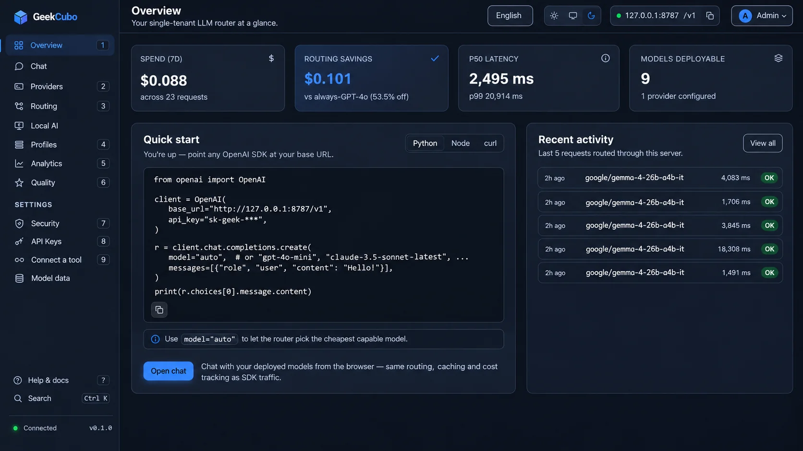
</p>

The **Overview** page shows 7-day spend, latency, deployable models, the most recent requests and a quick-start snippet for your endpoint.

## Architecture at a glance

```
 Your apps, SDKs and tools              GeekCubo (one container)                   Upstream models
 ─────────────────────────              ─────────────────────────                  ───────────────
 OpenAI SDK, curl, OpenCode ──┐         auth: sk-geek-* key (hash lookup)
 Claude Code / Anthropic SDK ─┼──────►  routing: auto · profile · pinned model ──►  OpenAI, Anthropic, Google, …
 google-genai SDK ────────────┘         fallback, cache, cost accounting      ──►  custom OpenAI-compatible providers
                                        SQLite/Postgres: keys, usage, policy  ◄──  Local AI Connect (outbound agent)
 Browser ──── dashboard (administrator session + CSRF) ──┘
```

## Install

**Prerequisites:** Linux, macOS or WSL with Docker Engine 24+ and the Compose v2 plugin (`docker compose version`), about 1 GB RAM and 2 GB disk.

```bash
git clone https://github.com/GeekCubo/GeekCubo-AI-Router.git
cd GeekCubo-AI-Router
./install.sh
```

The installer checks Docker and Compose, creates `.env` from `.env.example` only when it is missing, optionally sets up [web search](#optional-web-search), runs `docker compose up -d --build`, waits for `/health` and prints the dashboard URL. Rerunning it is safe: it never deletes the data volume or regenerates credentials.

| Address | What it is |
|---|---|
| `http://127.0.0.1:8787` | The dashboard (local only by default) |
| `http://127.0.0.1:8787/v1` | The OpenAI-compatible API base URL for clients on the same machine |
| `https://<your-host>` | Optional: your own HTTPS hostname behind a reverse proxy ([Security and deployment](#security-and-deployment)) |

<details>
<summary><b>Manual install (same Compose file)</b></summary>

```bash
cp .env.example .env
docker compose up -d --build

# Only while no administrator exists:
docker compose exec api python -m app.admin_cli setup-token
```

</details>

## First-time administrator setup

On a fresh install the installer prints a **one-time setup token** (also available with `docker compose exec api python -m app.admin_cli setup-token`). Open the dashboard, choose **Create Administrator Account**, and enter a username, a password of 8+ characters and the token. There are no default credentials and no public registration; the token is single-use and stops working once the account exists.

The dashboard signs in with that username and password. A normal session lasts 12 hours (60 minutes idle); **Remember me for 14 days** keeps a trusted browser signed in until a fixed expiry. Forgot the password? Run `docker compose exec api python -m app.admin_cli reset-password` on the host. Details: [Security](docs/security.md).

## Add providers

<p align="center">
  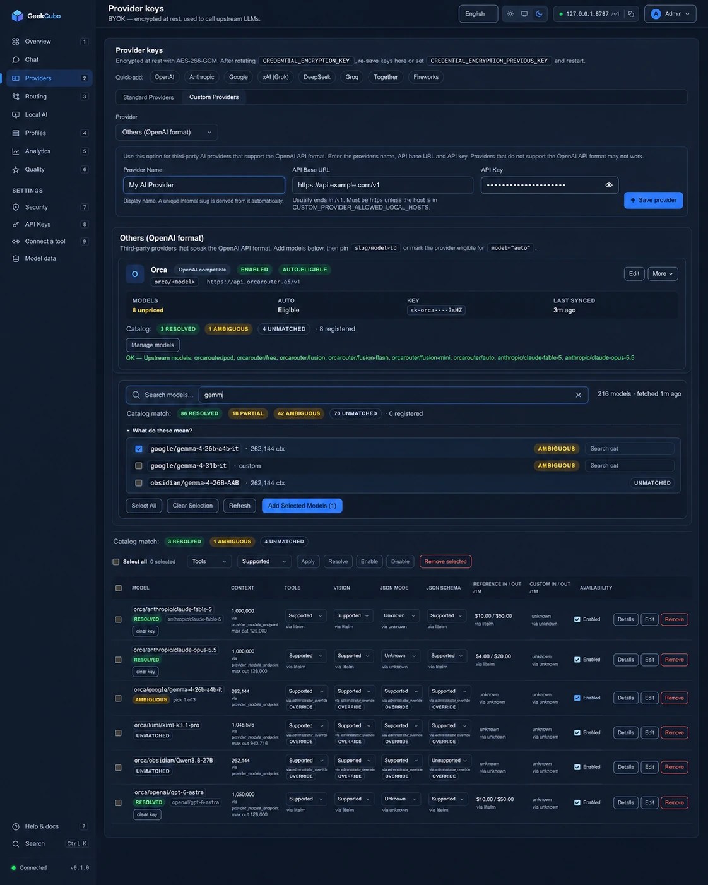
</p>

- **Built-in providers:** paste a key under **Providers**. Their catalog models become deployable immediately. Keys are encrypted at rest (AES-256-GCM).
- **Custom providers:** any OpenAI-compatible API (a reseller, a gateway, a self-hosted server). Enter a name, base URL and key, fetch the model list and register the models you want. Public providers must use HTTPS; private hosts need `CUSTOM_PROVIDER_ALLOWED_LOCAL_HOSTS`.
- **No required provider.** The screenshots use one OpenAI-compatible reseller as an example; any combination of built-in, custom and local providers works.
- **Metadata:** each model shows context window, prices and *Supported / Unsupported / Unknown* capabilities with their source. Unknown never counts as supported, and an unknown price is never treated as free. See [Model Intelligence](docs/model-intelligence.md).

## API keys and endpoints

<details>
<summary><b>Screenshot: API Keys page</b></summary>

<p align="center">
  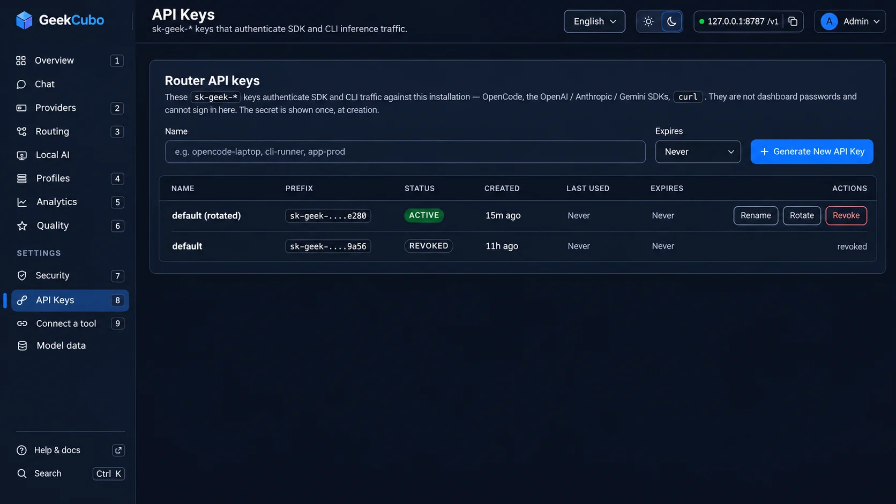
</p>

</details>

Three different things are called "API key" around GeekCubo. They are not interchangeable:

| Credential | Looks like | Where it belongs | What it does |
|---|---|---|---|
| **GeekCubo API key** | `sk-geek-...` | The **client**. Generated in **Settings → API Keys**, shown once, stored hash-only | Authenticates apps, SDKs and tools to GeekCubo |
| **Upstream provider key** | `sk-...`, `sk-ant-...`, … | The GeekCubo **server**: the Providers page or the server `.env` | Lets GeekCubo call OpenAI, Anthropic, a reseller, … |
| **Client variables** | `GEEKCUBO_API_KEY`, `OPENAI_API_KEY`, `OPENAI_BASE_URL` | The client's environment | `GEEKCUBO_API_KEY` is read by configs from Connect a tool; generic OpenAI SDKs read `OPENAI_API_KEY` and `OPENAI_BASE_URL` |

When a client sets `OPENAI_API_KEY` and points `OPENAI_BASE_URL` at GeekCubo, the value is your **GeekCubo key** — it does not have to be a key bought from OpenAI. The `OPENAI_API_KEY` in GeekCubo's *server* `.env` is different: your upstream OpenAI account. Lost an `sk-geek-*` key? It cannot be recovered; **Rotate** or **Revoke** it.

**Settings → API Keys** also shows the endpoint clients should use: your `PUBLIC_BASE_URL` with `/v1` when set, otherwise `http://127.0.0.1:8787/v1`. Details: [Which key goes where](docs/security.md#which-key-goes-where).

## Call it from an SDK

```python
from openai import OpenAI

client = OpenAI(
    base_url="http://127.0.0.1:8787/v1",   # or https://<your-host>/v1
    api_key="sk-geek-...",                  # a GeekCubo key
)
r = client.chat.completions.create(
    model="auto",                           # or a routing profile, or a specific model id
    messages=[{"role": "user", "content": "Hello!"}],
)
print(r.choices[0].message.content, r.model)   # r.model: the model that served it
```

<details>
<summary><b>Node.js, curl, streaming, Anthropic and Gemini SDKs</b></summary>

```js
import OpenAI from "openai";
const client = new OpenAI({ baseURL: "http://127.0.0.1:8787/v1", apiKey: process.env.GEEKCUBO_API_KEY });
const r = await client.chat.completions.create({ model: "auto", messages: [{ role: "user", content: "Hello!" }] });
console.log(r.choices[0].message.content);
```

```bash
curl http://127.0.0.1:8787/v1/chat/completions \
  -H "Authorization: Bearer $GEEKCUBO_API_KEY" \
  -H "Content-Type: application/json" \
  -d '{"model":"auto","messages":[{"role":"user","content":"Hello!"}]}'
```

Streaming uses the standard OpenAI SSE format (`stream=True`). Claude Code and the Anthropic SDKs use `/v1/messages`; the google-genai SDK uses `/v1beta/models`. Their base URLs have **no** `/v1` suffix, for example `ANTHROPIC_BASE_URL=http://127.0.0.1:8787`. See [Connecting tools and SDKs](docs/integrations.md).

</details>

## Connect OpenCode and other tools

<p align="center">
  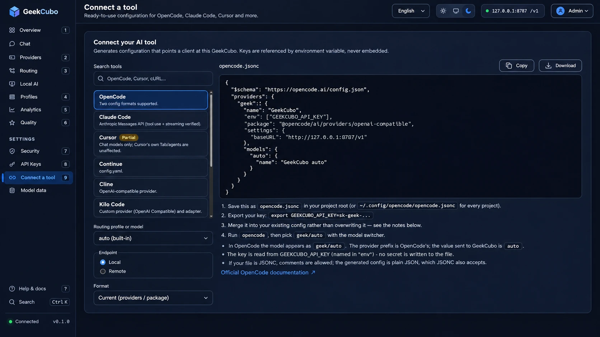
</p>

**Settings → Connect a tool** generates configuration for OpenCode, Claude Code, Cursor, Continue, Cline, Kilo Code, generic OpenAI clients, cURL and the Python/TypeScript SDKs. Choose a routing profile or model and the **Local** or **Remote** endpoint; keys are referenced through `GEEKCUBO_API_KEY` and never embedded. 

For OpenCode 2.x, save `opencode.jsonc` in your project or `~/.config/opencode/`:

```jsonc
{
  "$schema": "https://opencode.ai/config.json",
  "providers": {
    "geek": {
      "name": "GeekCubo",
      "env": ["GEEKCUBO_API_KEY"],
      "package": "@opencode/ai/providers/openai-compatible",
      "settings": { "baseURL": "http://127.0.0.1:8787/v1" },
      "models": { "auto": { "name": "GeekCubo auto" } }
    }
  }
}
```

Export `GEEKCUBO_API_KEY=sk-geek-...`, run `opencode`, and pick `geek/auto`. For a remote GeekCubo use `https://<your-host>/v1`.

<details>
<summary><b>Screenshot: OpenCode working through GeekCubo Auto</b></summary>

<p align="center">
  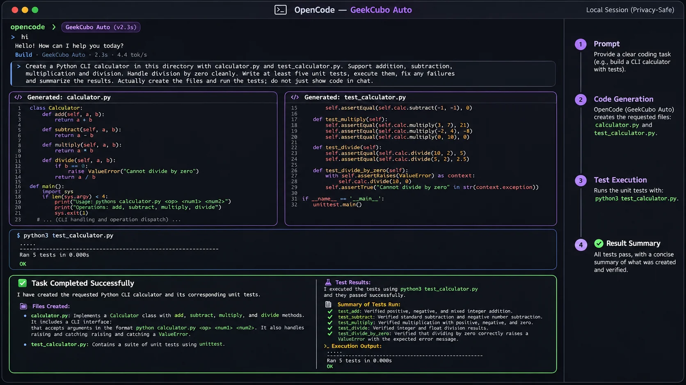
</p>

</details>

In the OpenCode screenshot, GeekCubo Auto handles a small coding task: it writes `calculator.py` and `test_calculator.py`, runs the tests and summarizes the result. Tool calling depends on the model GeekCubo routes to. Claude Code, Cursor and the OpenCode 1.x format are covered in [Connecting tools and SDKs](docs/integrations.md).

## Automatic routing

<p align="center">
  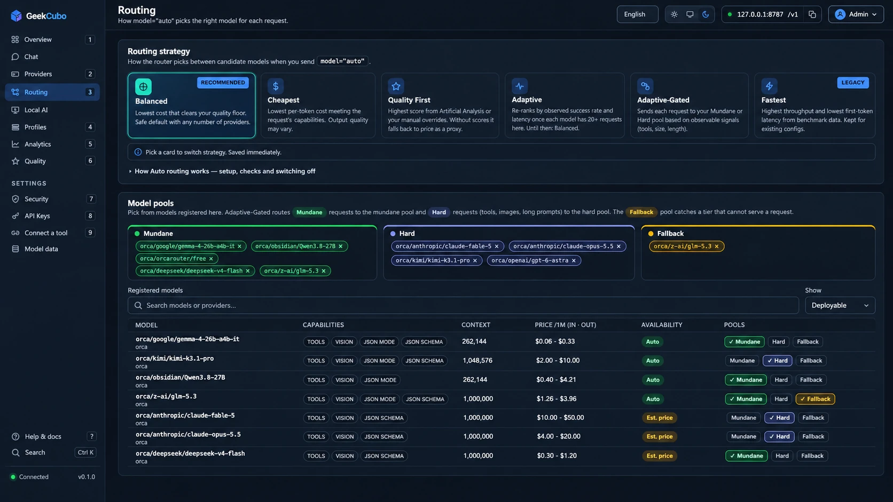
</p>

Send `model="auto"` (or a routing-profile id) and GeekCubo:

1. keeps only **eligible** models: enabled providers with working keys, enabled models, approved local machines;
2. requires a **confirmed price** — an unknown price is never treated as free;
3. requires every **capability** the request needs (tools, vision, JSON mode, JSON Schema) to be *Supported*;
4. drops models whose known **context window** is too small, and applies the key's allowlist and the profile's restrictions;
5. **ranks** the rest with the selected strategy and tries them in order, up to the fallback limit.

| Strategy | Ranks by |
|---|---|
| **Balanced** (default) | Quality score and blended price, equally weighted |
| **Cheapest** | Lowest blended price |
| **Quality First** | Highest quality score (Artificial Analysis or your manual scores) |
| **Adaptive** | Observed success rate and latency from this installation's own log |
| **Adaptive-Gated** | Sends simple requests to the *Mundane* pool and demanding ones (tools, images, long prompts) to the *Hard* pool |

The chosen model is returned in `x-geek-resolved-model`. If nothing qualifies, the request fails with a 422 that names the filter that emptied the pool instead of guessing. **Routing profiles** are named Auto configurations (strategy, allowlist, price ceiling, fallback limit) that clients select by model id; a fallback can never escape its profile. **Test a routing decision** on the Routing page shows the reasoning without calling any model. Full details: [Routing](docs/routing.md).

## Chat and attachments

<p align="center">
  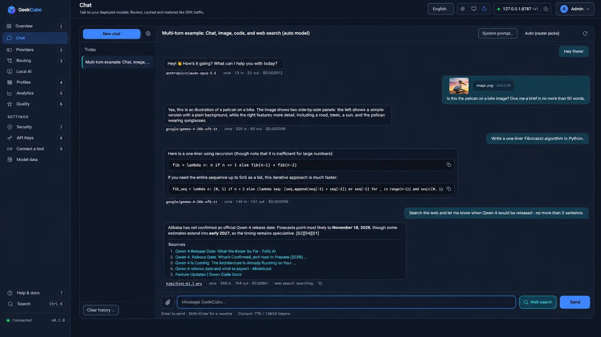
</p>

The **Chat** tab talks to your deployed models through the same pipeline as SDK traffic, so Auto, profiles, caching and cost tracking behave identically. Pick **Auto (router picks)**, a profile or any model per conversation; each reply shows the model that answered, its tokens and cost. Replies stream, **Stop** ends the upstream request, and conversations live only in your local database with configurable retention. The header shows the context budget, so a trimmed history is never mistaken for a model failure.

<details>
<summary><b>Image and file attachments</b></summary>

<p align="center">
  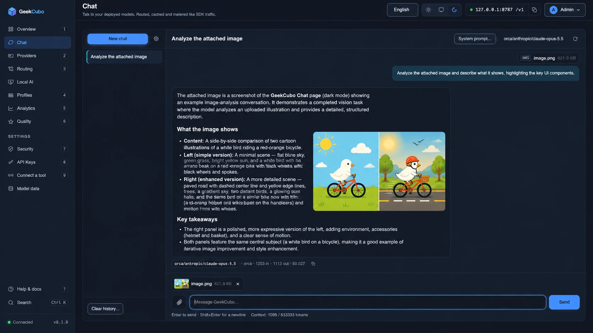
</p>

Attach files with the paperclip, drag-and-drop or paste: images (sent to vision-capable models), PDF/DOCX/RTF, spreadsheets, text and code, archives (listed, never unpacked to disk), and video/audio (metadata; video frames need `ffmpeg`). Files are verified by content, stored under opaque names and served only to the administrator. Pinning a model without vision support rejects image sends instead of silently dropping the file. Limits: 8 files per message, 25 MB per file by default (`ATTACHMENT_MAX_MB`). See [Chat](docs/chat.md).

</details>

## Optional web search

Chat can search the web before answering and cite the pages it used. **Search is off by default and entirely optional**: GeekCubo routes and chats normally without SearXNG, Brave or Tavily, and search credentials are stored separately from model-provider credentials. Configure everything in **Chat → ⚙ Chat settings → Web search**:

- **Search mode:** `Off` (default) or `Manual (per message)`, which adds a search toggle to the composer. `Auto` is reserved and **not yet implemented**.
- **Search backend:** SearXNG (URL), Brave Search API or Tavily (API key, stored encrypted and never shown again).
- **Limits:** searches per conversation, results per search, pages fetched per search and a timeout; hard caps apply server-side.
- **Test connection** runs one real query and reports the result count and latency without saving.

A search that fails is reported as a failure in the composer, never presented as a successful search; citations are shown only for URLs the backend actually returned. `./install.sh` offers the same choices interactively.

**1. Private SearXNG container (bundled).** From the repository directory, start the optional `searxng` service with the Compose `search` profile:

```bash
docker compose --profile search up -d     # start GeekCubo plus SearXNG
docker compose --profile search down      # stop both; volumes are kept
```

SearXNG runs on the internal Compose network with no published port, so it is reachable **from the GeekCubo container** as `http://searxng:8080/` — not from your browser. Enter that URL as the SearXNG backend, select **Manual**, then **Test connection**. The installer generates `SEARXNG_SECRET` in `.env`; the image is pinned in `docker-compose.yml` and capped at 512 MB. A failing SearXNG never stops GeekCubo.

**2. Existing SearXNG server.** Choose the SearXNG backend and enter your instance's base URL. It must be reachable from inside the GeekCubo container (`127.0.0.1` there means the container itself) and must have the `json` format enabled in its `settings.yml`; otherwise the test reports that SearXNG did not return JSON.

**3. Brave Search** or **4. Tavily.** External APIs with no container: create a key in your own Brave Search API or Tavily account, choose the backend, paste the key and use **Test connection**. Usage is billed by that service under its terms.

## Local AI Connect

<details>
<summary><b>Screenshot: Local AI Connect</b></summary>

<p align="center">
  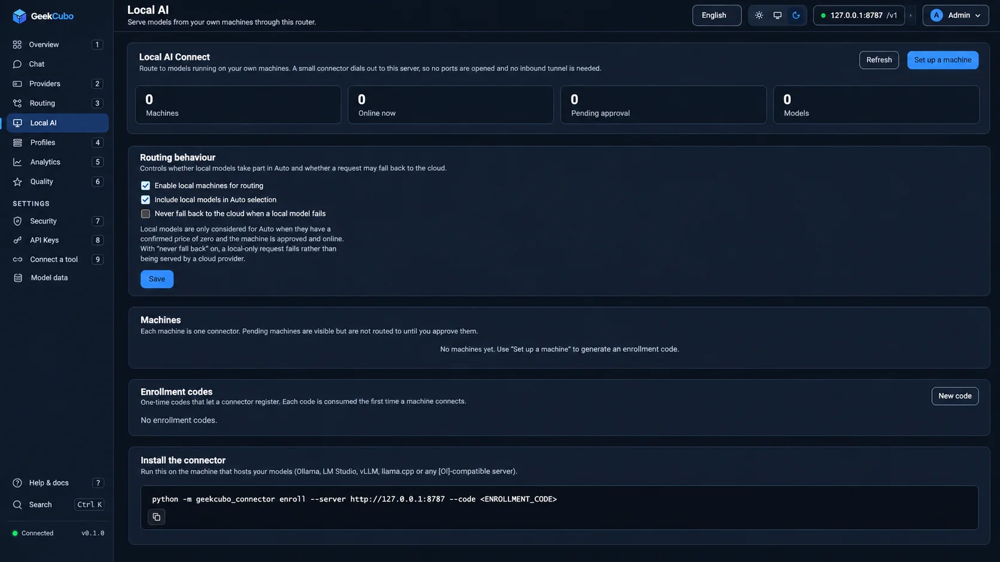
</p>

</details>

Bring models running on your own hardware (Ollama, LM Studio, vLLM, llama.cpp or any OpenAI-compatible server) into the same catalog and routing. A small connector dials **out** to GeekCubo over WebSocket, so no inbound port, tunnel or VPN is needed:

```bash
pip install .     # on the model host (Python 3.11+), from a checkout of this repository
geekcubo-connector enroll --server https://<your-host> --code lcenr-...
geekcubo-connector run
```

Enrollment codes are single-use and expire after 30 minutes; a machine gets nothing until you approve it. Local models appear as `local/<machine>/<model>`, can be pinned or included in Auto, and can be configured never to fall back to the cloud. **Tool calls are not returned through the connector**, so Auto never sends tool-using requests to local models. See [Local AI Connect](docs/local-ai-connect.md).

## Analytics and cost tracking

<details>
<summary><b>Screenshot: Analytics</b></summary>

<p align="center">
  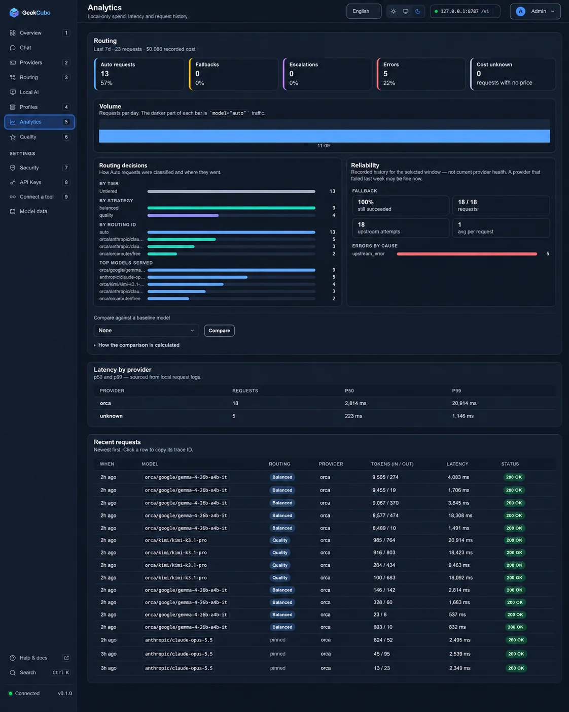
</p>

</details>

**Analytics** is computed from the local request log; no telemetry leaves your server. It shows error, Auto, fallback and escalation rates, how Auto requests were classified, the top models served, p50/p99 latency per provider, and every recent request with its model, routing decision, tokens, latency and status. Costs use confirmed prices only; requests with an unknown price are counted as such, never as free. An optional baseline comparison reports what the same traffic would have cost on one model at its list price. See [API endpoints and features](docs/api.md).

## Security and deployment

- **Loopback by default.** Compose publishes the dashboard on `127.0.0.1:8787` only; the administrator login is not meant to face the internet directly. For remote use, open an SSH tunnel (`ssh -L 8787:127.0.0.1:8787 <user>@<server>`) or put a TLS reverse proxy in front, set `TRUST_PROXY_HEADERS=true` and set `PUBLIC_BASE_URL` to your own address (for example `https://api.example.com`). See [DEPLOYMENT.md](DEPLOYMENT.md).
- **Generated secrets.** On first start GeekCubo creates `CREDENTIAL_ENCRYPTION_KEY` and `API_KEY_PEPPER` in `.geekcubo-secrets` (mode `0600`) next to the database. Without them stored provider keys cannot be decrypted.
- **Data and backups.** Everything lives in the `geekcubo-data` volume (`/data`): the database, attachments and the secrets file. Back it up with the service stopped (`docker compose cp api:/data ./geekcubo-data-backup`). Updates and `./install.sh` keep the volume; **never run `docker compose down -v`**, which deletes it.
- **Credentials.** `sk-geek-*` keys are stored hash-only, provider keys encrypted; dashboard sessions are HttpOnly, `SameSite=Lax`, `Secure` over HTTPS and CSRF-protected. `sk-geek-*` keys cannot open the dashboard, and a dashboard session cannot call the inference API.

<details>
<summary><b>Updating, running without Compose, and the encryption key</b></summary>

Update with `git pull`, then `docker compose build api && docker compose up -d api` after a backup; startup migrations add what the release needs. Without Compose, build the image and run it with `-p 127.0.0.1:8787:8000 -v geekcubo-data:/data` (see the appendix in [DEPLOYMENT.md](DEPLOYMENT.md)). Rotating `CREDENTIAL_ENCRYPTION_KEY` is a controlled, documented procedure: [Security → Encryption at rest](docs/security.md#encryption-at-rest).

</details>

## Limitations

- **Single workspace, single process.** No multi-tenancy, RBAC or SSO, and no multi-worker or multi-replica deployment ([scope](docs/architecture.md#scope-what-geekcubo-deliberately-is-not)).
- **Local AI Connect does not return tool calls**, so tool-using requests never route to local models.
- **Web search** is manual per message; the automatic mode is reserved and not implemented. Audio attachments are passed as metadata only; there is no transcription.
- **Cursor** works for chat models only; Cursor's own Tab completion and background agents keep using Cursor's models. Anthropic-hosted extras outside the Messages API are not available.
- **Inference endpoints** are chat completions, Anthropic Messages (with token counting), Gemini `generateContent` and model listing; embeddings and image generation are not proxied.
- Generated client configurations follow each tool's documented format. The OpenCode configs were verified with OpenCode 2.2.6 for text generation; agentic tool calling also depends on the routed model.

## Troubleshooting and documentation

<details>
<summary><b>Common problems</b></summary>

- **Installer or container fails:** `docker compose ps` and `docker compose logs --tail=100 api`, then rerun `./install.sh` (it keeps your data).
- **Request fails with 422:** no model passed Auto's filters. Read `x-geek-routing-diagnosis`, or use **Routing → Test a routing decision**; common causes are no provider key, no confirmed price, or a required capability marked Unknown.
- **401 from the API:** the client must send an `sk-geek-*` key, not a provider key or the dashboard password.
- **Cannot sign in after an HTTPS proxy change:** set `TRUST_PROXY_HEADERS=true` so cookies get the `Secure` flag.
- **Web search test fails:** check the URL is reachable from the container and SearXNG has the `json` format enabled, or re-enter the Brave/Tavily key.

</details>

| Guide | Contents |
|---|---|
| [Security & API keys](docs/security.md) | Administrator account, sessions, keys, encryption, backups, troubleshooting |
| [Routing](docs/routing.md) | Auto, strategies, policies, profiles, fallback |
| [Model Intelligence](docs/model-intelligence.md) | Metadata sources, pricing, capabilities |
| [Connecting tools and SDKs](docs/integrations.md) | Connect a tool, OpenCode, Claude Code, native protocols |
| [Local AI Connect](docs/local-ai-connect.md) · [Chat](docs/chat.md) | Local models; dashboard chat, web search, attachments |
| [API endpoints](docs/api.md) · [Architecture](docs/architecture.md) | Endpoints, catalog, cache; source layout, tests, roadmap |
| [Deployment](DEPLOYMENT.md) | VPS, reverse proxy, backup, upgrades |
| [Contributing](CONTRIBUTING.md) · [Security policy](SECURITY.md) · [Code of Conduct](CODE_OF_CONDUCT.md) | Fork-and-PR workflow, tests, review; private vulnerability reports |

## Support GeekCubo

GeekCubo is free, open-source, and independently developed. You can support its continued development by exploring services that complement your AI setup.

- [**AI API Providers**](https://geekcubo.com/providers/) — Discover compatible AI model providers.
- [**VPS & Cloud Hosting**](https://geekcubo.com/hosting/) — Explore hosting options for self-hosted deployments.
- [**VPN & Privacy**](https://geekcubo.com/vpn/) — Explore optional privacy and secure networking tools.

**Affiliate disclosure:** Some links may earn us a commission at no additional cost to you. Using them is optional and does not influence GeekCubo's model routing or provider compatibility.

## License

MIT. See [LICENSE](./LICENSE).

GeekCubo is derived from OrcaRouter Lite. The upstream MIT license and its
copyright notice ("Copyright (c) 2026 OrcaRouter contributors") are preserved
in [LICENSE](./LICENSE) and must be kept in copies and substantial portions of
the software.

Third-party assets keep their own licenses: the font outlines used in the logo
(Inter, SIL Open Font License 1.1) are covered by
[design/brand/FONT-LICENSE.txt](./design/brand/FONT-LICENSE.txt).
